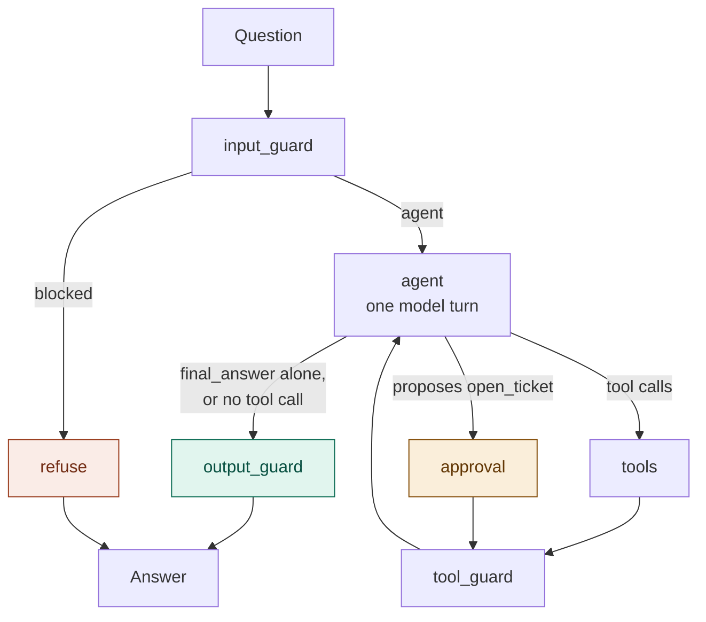
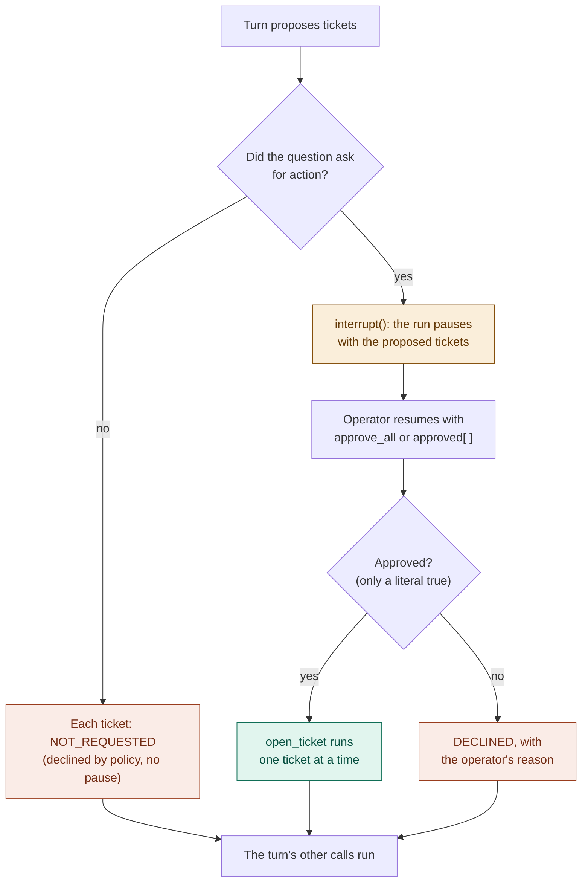

# Agent flows

How `rampart.agent` runs a question: the graph that wires the guard nodes around the agent, the approval
step before the only side-effecting tool, and what the runner keeps per thread. The guard nodes themselves
are drawn in [GUARDRAIL_FLOWS.md](GUARDRAIL_FLOWS.md).

Colours: green passes, red blocks or declines, amber pauses for a person.

## The graph

`rampart.agent.graph.build_triage_graph` wires the real nodes; `route_after_agent` decides after every
model turn.

| The model's turn | Goes to | Notes |
|---|---|---|
| no tool call (plain text) | output guard | first converted into `final_answer` by one constrained call |
| `final_answer` alone | output guard | the arguments are validated against `FinalAnswer` and rendered |
| tool calls, possibly with `final_answer` | tools | a batched `final_answer` is answered `PREMATURE_FINAL` and the model asked again |
| any call to `open_ticket` | approval | the turn's other calls run there too, after the decision |

Past either budget (24 tool calls or 7 turns in a run) the model is bound to `final_answer` alone, so a
run always ends with an answer the output guard can check.

## The tool step

`tools` runs the turn's calls concurrently and answers every call in order. It never raises: anything
that is not a tool result comes back as an error envelope the model can read.

| Call | Result |
|---|---|
| a tool that answered | the tool's own envelope |
| `final_answer` batched with other calls | `PREMATURE_FINAL` |
| `open_ticket` (unreachable through the router) | `APPROVAL_REQUIRED`, the ticket tool is not called |
| a name that is not a tool | `UNKNOWN_TOOL`, with the valid names |
| arguments the schema rejects | `INVALID_INPUT` |
| a tool that raised (MCP `isError`, transport) | `TOOL_ERROR` |

## The approval step

`approval` is the only path to `open_ticket`.

- "Asked for action" is `wants_action`: open, create, file or raise a ticket, or "go ahead". The prompt
  says the same, but the rule is code because the model proposed tickets on plain triage questions.
- On resume LangGraph re-runs the node from its start; nothing before `interrupt()` has a side effect, so
  the ticket and the turn's other calls run once.
- A missing flag, a malformed decision or any value other than `true` declines.

## A run and its thread

`rampart.agent.runner.Rampart` runs one question per call on a thread (the conversation).

| Status | When |
|---|---|
| `delivered` | the output guard passed the answer |
| `withheld` | the output guard withheld it (the answer says why) |
| `blocked` | the input guard refused the question |
| `paused` | the approval step is waiting for an operator |
| `failed` | the run raised; the answer gives the run id, the audit row has the error |

- The conversation (`messages`) carries over between runs on a thread. The evidence does not: the guardrail
  log, the tools that answered and the retrieved chunks start empty for every run, so a follow-up that cites
  a tool which ran only for an earlier question is withheld.
- Runs on one thread never overlap. A paused thread takes no new question (`ApprovalPending`) and a thread
  that is not paused cannot be resumed (`NothingToResume`).
- Tool calls left without a result by a run that stopped early are answered `NOT_RUN` before the next
  question, so the thread stays usable.
- One audit row per run. A resumed run adds its tokens, cost and latency to the row of its first part.
