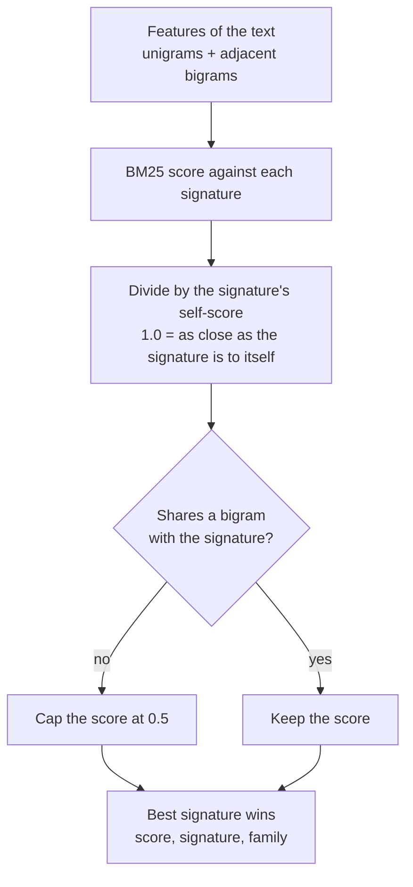
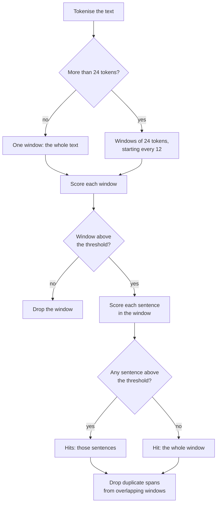
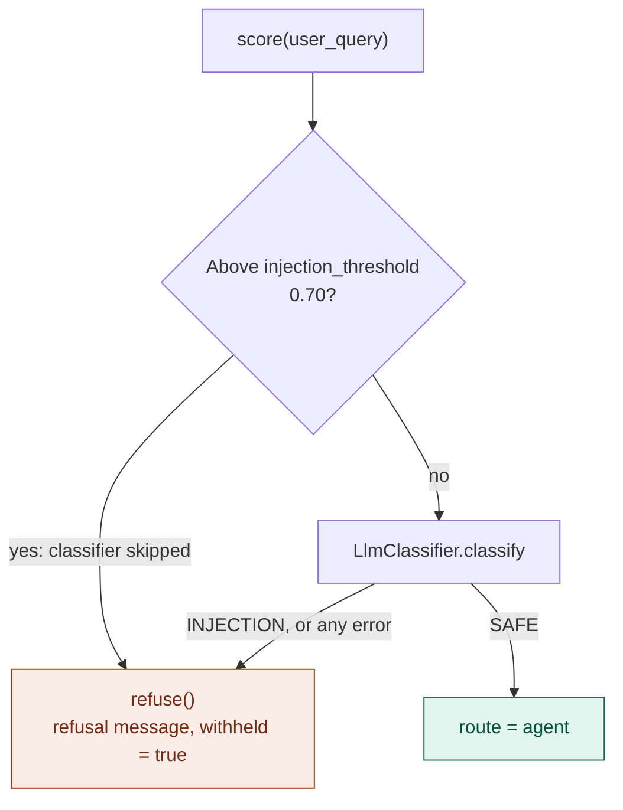
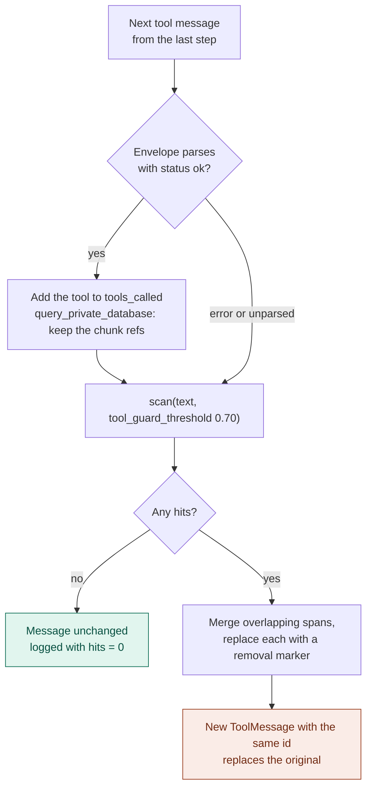
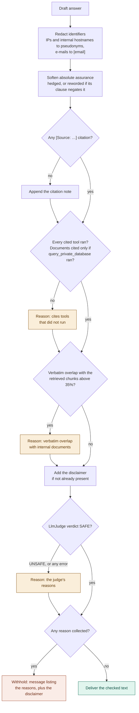

# Guardrail flows

Every path through the guardrail code in `rampart.guardrails`: the signature index the input guard and
the tool guard share, the three guard nodes and `refuse`. Each node is a plain function over the graph
state and writes one `guardrail_log` entry per decision, with the scores that produced it. How the
graph wires the nodes together (agent, tools, approval) is drawn in [AGENT_FLOWS.md](AGENT_FLOWS.md).

Colours: green passes, red blocks or withholds, amber records a reason to withhold.

## Signature scoring

### Scoring one piece of text

`SignatureIndex._best` scores a token sequence against every signature and keeps the best.

- The cap stops one common word ("rules", "instructions") spread across a benign sentence from acting
  as a wildcard: without a shared bigram a signature can't score above 0.5, below every threshold.
- `SignatureIndex.load` rejects a signature with fewer than two tokens, so every signature has a bigram
  and the cap always applies when none is shared.
- Tokens are lowercase words of two or more characters, minus stopwords, with plurals stemmed
  ("rules" → "rule"), identically for signatures and text.

### Finding hits in a text

`SignatureIndex.scan(text, threshold)` finds the passages that score above a threshold, with character
offsets so they can be removed.

`SignatureIndex.score(text)` is `scan(text, threshold=-1)` and returns the best hit. With a threshold
of −1 every window passes, and any sentence that matches any signature at all counts as above it, so the
score is the best sentence score; a window's own score is used only when no sentence in it matches
anything. An empty text scores 0.

## Input guard and refuse

`Guards.input_guard` decides whether the analyst's question reaches the agent. Two layers: the
signature score, then the LLM classifier.

| Outcome | `route` | Log | What the user sees |
|---|---|---|---|
| Signature hit | `blocked` | `rule_hit: true`, `llm_reason: "skipped: layer 1 fired"` | Refusal naming "signature match" |
| Classifier hit | `blocked` | `llm_hit: true` with the classifier's reason | Refusal naming "classifier" |
| Classifier error or timeout | `blocked` | `llm_hit: true`, `llm_error` set (fails closed) | Refusal naming "classifier" |
| Passed | `agent` | `rule_hit: false`, `llm_hit: false` | Nothing yet; the agent runs |

`refuse` reads the last log entry to name the layer that fired, and sets both `delivered` and `withheld`.

## Tool guard

`Guards.tool_guard` runs after every tool step, once per tool message the step produced (the trailing
`ToolMessage`s). It removes injected passages before the agent reads them, and records which tools
answered and which chunks were retrieved, for the output guard.

- Error and unparsed results are scanned too (an error message can carry injected text), but they don't
  count as a tool that answered, so a later citation of that tool is withheld by the output guard.
- A hit removes the matching sentence when one scores above the threshold, otherwise the whole 24-token
  window (see [Finding hits in a text](#finding-hits-in-a-text)).
- The replacement keeps the original message id, so the `add_messages` reducer overwrites the original
  instead of appending.
- Each message gets a log entry with its status, the number of hits, the best score, the signature
  families and up to two examples of the removed text.

## Output guard

`Guards.output_guard` checks the agent's draft answer in a fixed order. Two steps change the text
without blocking it, three can add a reason to withhold it, and any reason withholds the answer.

- The judge always runs, last, on the text the user would see, even when an earlier step already found
  a reason to withhold. It fails closed: an error or timeout is the verdict `ERROR`, which withholds.
- The citation check reads tool names from `[Source: …]`. A citation that names anything else (a
  document title) counts as a document citation and needs `query_private_database` to have run.
- The overlap check is the share of the answer's 10-word sequences found verbatim in the chunks the tool
  guard recorded. With no recorded chunks, no chunk store, or an error fetching them, the ratio is 0 and
  the check passes; a fetch error is logged as `overlap_error`.
- When the draft came from the `final_answer` tool, the guard also answers that tool call, so the
  message history stays well formed.
- The log entry records the redaction counts, the softening changes, the cited and uncalled tools, the
  overlap ratio, whether the disclaimer was added, the judge's verdict and reasons, and `withheld_why`.
